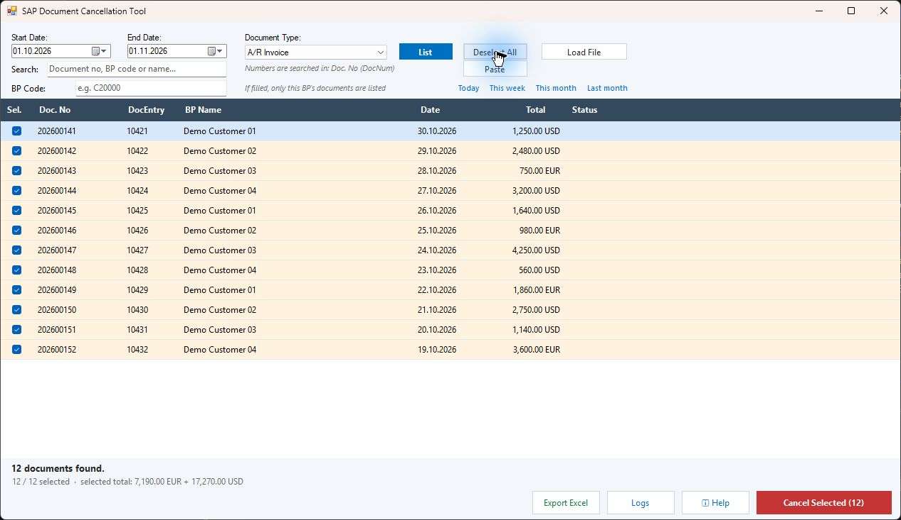
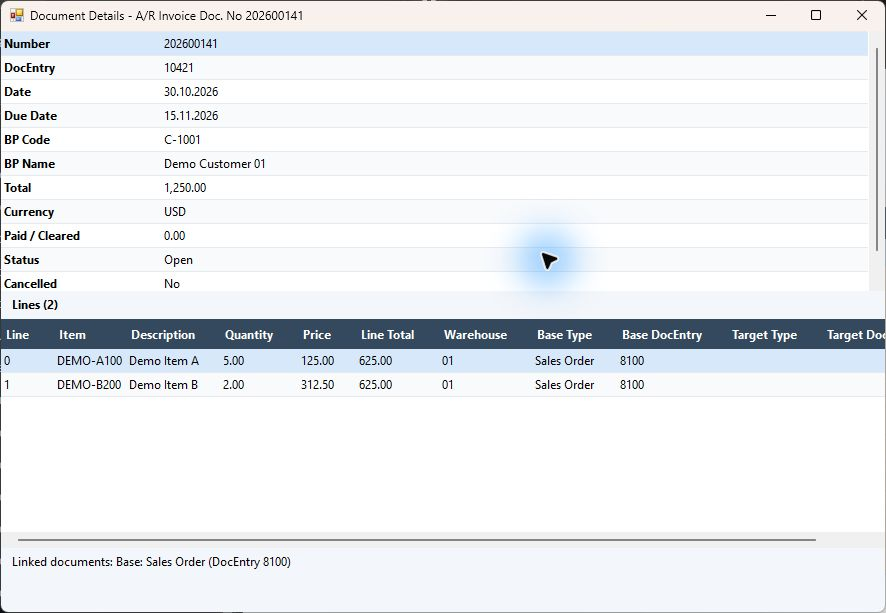
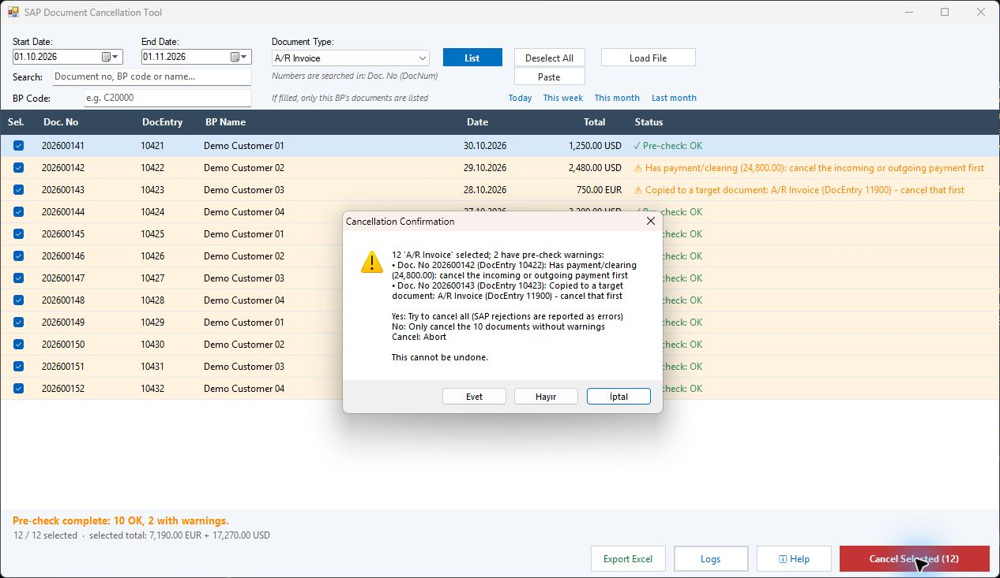

# SAP Business One Document Cancellation Tool

**English** · [Türkçe](README.tr.md)

A desktop application for listing, reviewing and cancelling SAP Business One documents in batches, with closure for supported document types.

- English and Turkish interface
- 23 document types
- Pre-checks and document details
- Import document numbers from files or the clipboard
- Excel export and operation logs

This repository presents the application and its screenshots. Source code is not distributed here. Screenshots contain sample data.

## Main screen

## Document details

## Pre-check

