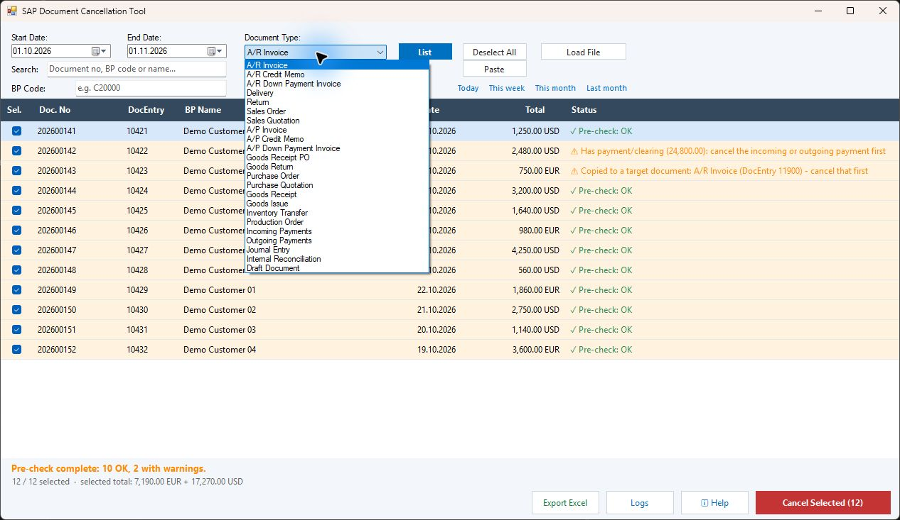
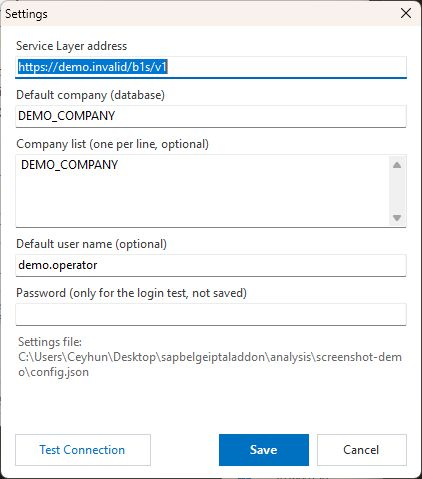
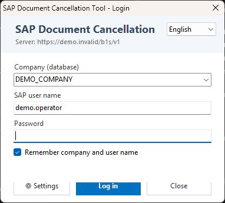
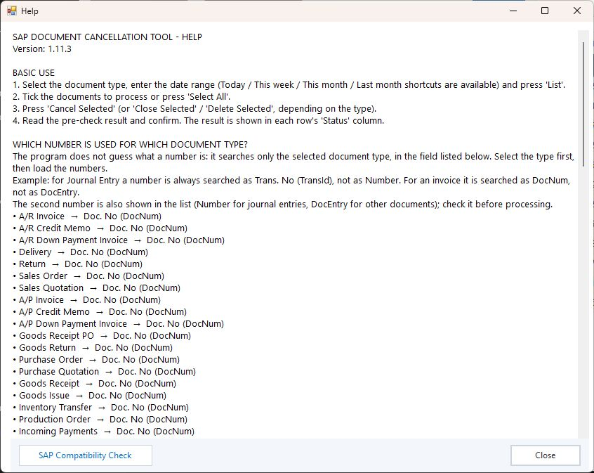

# SAP Business One Document Cancellation Tool — Showcase & Documentation 📄⚙️

**English** | [Türkçe](README.tr.md)

**A specialized enterprise desktop utility for batch listing, pre-flight validation, reversal cancellation, and closure across 23 SAP Business One document types.**

> ℹ️ **About This Showcase:**  
> This repository is a **product showcase and technical portfolio**. The underlying application source code (C#, .NET, SAP Service Layer, and DI API integration code) is maintained in an internal private repository. This repository provides feature breakdowns, supported document matrix, and UI screenshots taken in a sanitized sample environment.

---

## 📸 Screenshots & UI Walkthrough

| Main Overview (Batch Document Listing & Cancellation Workspace) |
|---|
|  |

| Document Type Selection (23 SAP Document Categories) | Document Details & Line Items Inspector |
|---|---|
|  |  |

| Pre-Check Validation & Confirmation Modal | Settings & SAP Connection Management |
|---|---|
|  |  |

| User Authentication | Help & Guidance Documentation |
|---|---|
|  |  |

---

## 🎯 Key Capabilities & Engineering Features

* **23 Supported Document Types:** Covers the entire operational lifecycle spanning Sales, Purchasing, Inventory, Banking, and Production in SAP Business One.
* **Pre-Flight Validation Engine:** Prevents erroneous cancellations by verifying document state, posting period status, base/target document chains, and existing reconciliations before executing cancellations.
* **Bulk Import:** Seamlessly ingest hundreds of document keys via Excel files (`.xlsx`, `.xls`), plain text files, or direct clipboard copy-paste.
* **Bilingual Localization:** Fully localized in English and Turkish with dynamic UI switching and locale-aware number/currency formatting.
* **Audit Trails & Excel Export:** Generates timestamped audit logs for every operation with detailed SAP response messages and one-click Excel reporting.

---

## 📋 Supported SAP Document Matrix

| Category | Supported Documents |
|---|---|
| **Sales (A/R)** | A/R Invoices, Credit Memos, Down Payment Invoices, Deliveries, Returns, Sales Orders, Sales Quotations |
| **Purchasing (A/P)** | A/P Invoices, Credit Memos, Down Payment Invoices, Goods Receipt POs (GRPO), Goods Returns, Purchase Orders, Quotations |
| **Inventory** | Goods Receipts, Goods Issues, Inventory Transfers |
| **Banking & Finance** | Incoming Payments, Outgoing Payments, Journal Entries, Internal Reconciliations |
| **Production & Drafts** | Production Orders, Draft Documents |

---

## 💻 Technical Stack

- **Desktop Framework:** C#, .NET, Windows Forms, Modern Custom UI Controls
- **SAP Integration:** SAP Business One Service Layer (OData REST) and DI API
- **Reporting & Export:** ClosedXML / Excel interop, Serilog audit logging

---

## 🔒 Confidentiality Notice
Application source code and SAP connection credentials are not published in this repository. Screenshots reflect sanitized development sample data.
