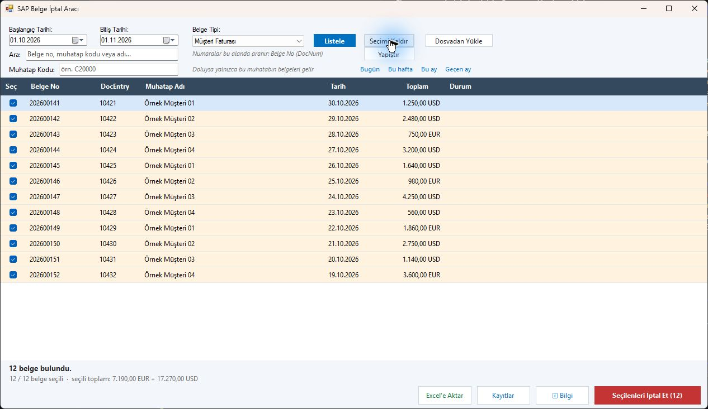
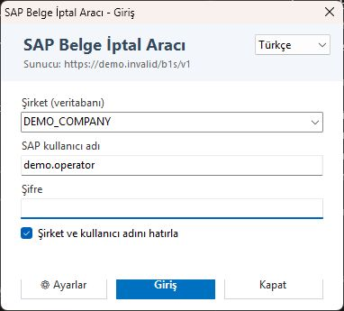
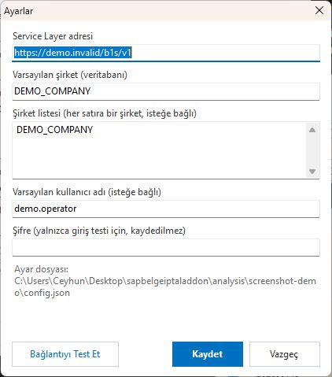
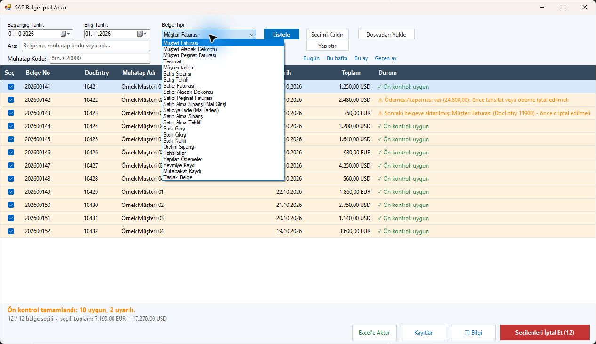
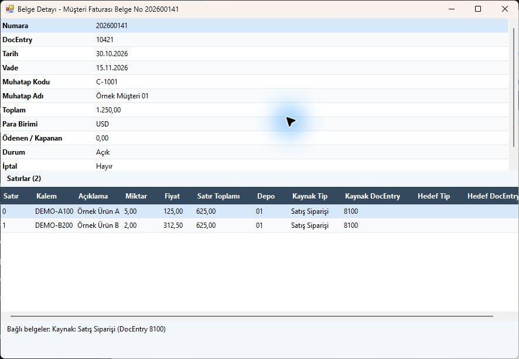
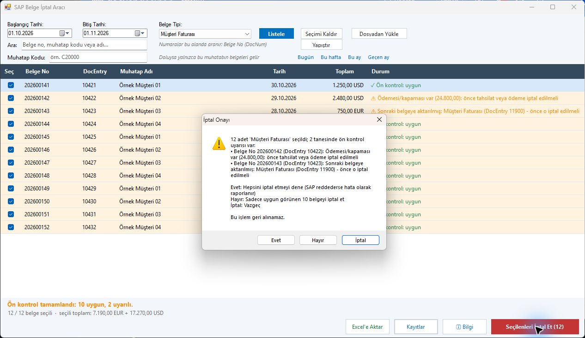
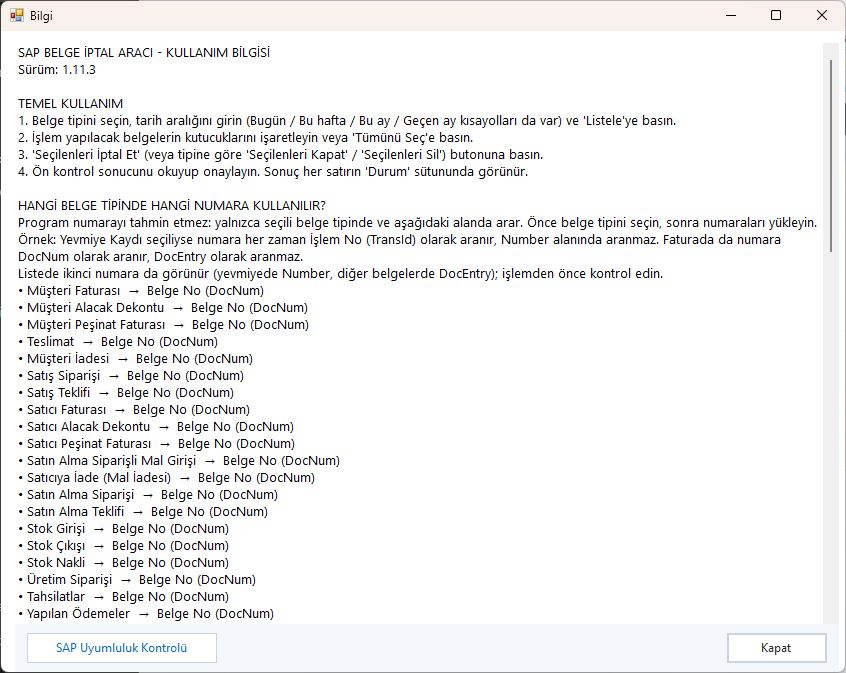

# SAP Business One Belge İptal Aracı

[English](README.md) · **Türkçe**

SAP Business One belgelerini toplu olarak listeleme, inceleme, iptal etme ve desteklenen türlerde kapatma uygulaması.

- Türkçe ve İngilizce arayüz
- 23 belge türü, işlem öncesi kontrol ve belge detayı
- Dosyadan veya panodan numara yükleme
- Excel çıktısı ve işlem kayıtları

Bu depo yalnızca uygulamanın tanıtımını ve ekran görüntülerini içerir. Kaynak kod paylaşılmaz. Görsellerde örnek veriler kullanılmıştır.

## Belge türleri

| Alan | Desteklenen belgeler |
| --- | --- |
| Satış | Müşteri faturası, alacak dekontu, peşinat faturası, teslimat, müşteri iadesi, sipariş, teklif |
| Satın alma | Satıcı faturası, alacak dekontu, peşinat faturası, mal girişi, mal iadesi, sipariş, teklif |
| Stok | Stok girişi, stok çıkışı, stok nakli |
| Finans | Tahsilat, ödeme, yevmiye kaydı, iç mutabakat |
| Diğer | Üretim siparişi, taslak belge |

## Ekran galerisi

Görselleri büyütmek için üzerlerine tıklayabilirsiniz.

| Giriş | Ayarlar |
| --- | --- |
|  |  |

| Belge türleri | Belge detayı |
| --- | --- |
|  |  |

| Ön kontrol ve onay | Yardım |
| --- | --- |
|  |  |